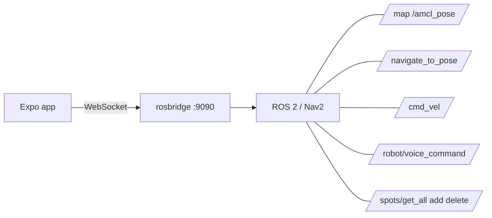

# Sanad

Sanad (سند, "support") is an Expo mobile/web controller for a ROS wheelchair. It shows a 3D occupancy map, sends Nav2 goals, streams joystick teleop and voice commands, and manages saved spots (named poses).

## Prerequisites

- Node.js 20+
- Expo CLI (`npx expo` is enough; no global install required)
- ROS 2 with [rosbridge_suite](https://github.com/RobotWebTools/rosbridge_suite):

  ```bash
  ros2 launch rosbridge_server rosbridge_websocket_launch.xml  # ws://localhost:9090
  ```

- Optional, for spots: the `sanad_room_manager` package's `spots_manager_node` (exposes `/spots/get_all|add|delete` via `sanad_interfaces` in `sanad_ws`).

## Setup

```bash
cp .env.example .env
```

`EXPO_PUBLIC_ROSBRIDGE_URL` is only the **initial** address (simulator / same-machine). On a phone, use the **Connect** pill in the top bar:

- **Auto scan network** — probes your LAN (default port 9090) for rosbridge and connects to the first hit.
- **Enter IP** — type the chair’s address (e.g. `192.168.1.20`) and Connect.

The chosen URL is stored on-device (AsyncStorage) and reused on the next launch. Phone and chair must share the same Wi‑Fi; rosbridge must be reachable on the LAN (`ros2 launch rosbridge_server rosbridge_websocket_launch.xml`).

| Where the app runs | Initial URL |
|---|---|
| Android emulator / iOS simulator / web on same machine | `ws://localhost:9090` |
| Physical device | Use Connect → auto scan or enter the chair’s LAN IP |

## Run

```bash
npm install
npm start          # Expo dev server
npm run android    # or: npm run ios / npm run web
```

## Checks

```bash
npm run lint       # npx expo lint
npx tsc --noEmit   # typecheck
npm test           # jest unit tests (pure logic; ros bridge is mocked)
```

## Architecture

```
app/                 expo-router screens (index = map controller, settings)
components/          UI (TopBar, Connect panel, Controls, Joystick, Pin modals, …)
  map/               pure 3D modules: camera, gestures, meshes, markers, sceneSetup, texture
contexts/            React state: Map, Navigation, Pinpoints, Joystick, Theme
services/            ROS layer:
  ros.ts             websocket connection (singleton, reconnect, runtime setUrl)
  discovery.ts       LAN scan for rosbridge :9090
  wsUrl.ts           URL normalize helpers
  MapService.ts      /map, /amcl_pose, Nav2 goal action, snap/error helpers
  SpotsService.ts    /spots/* service calls + response mapping
  VoiceService.ts    /robot/voice_command
  WheelchairService.ts  /cmd_vel teleop
```



## Key ROS interfaces

| Topic / service | Type | Used for |
|---|---|---|
| `/map` | `nav_msgs/OccupancyGrid` | 3D map rendering, goal snapping |
| `/amcl_pose` | `geometry_msgs/PoseWithCovarianceStamped` | robot pose / follow camera |
| `/navigate_to_pose` | `nav2_msgs/action/NavigateToPose` | autonomous goals |
| `/cmd_vel` | `geometry_msgs/Twist` | joystick teleop |
| `/robot/voice_command` | `std_msgs/String` | voice commands |
| `/spots/get_all` `/spots/add` `/spots/delete` | `sanad_interfaces/srv/*` | saved spots (pinpoints) |

## License

See [LICENSE](./LICENSE).
